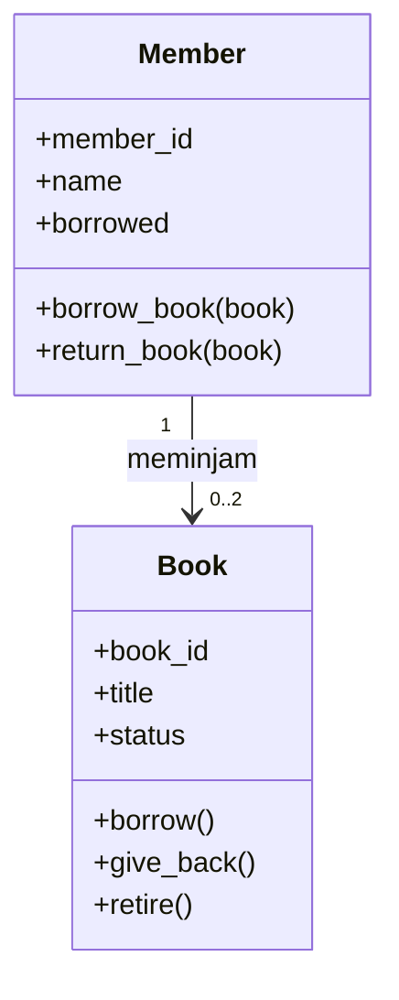
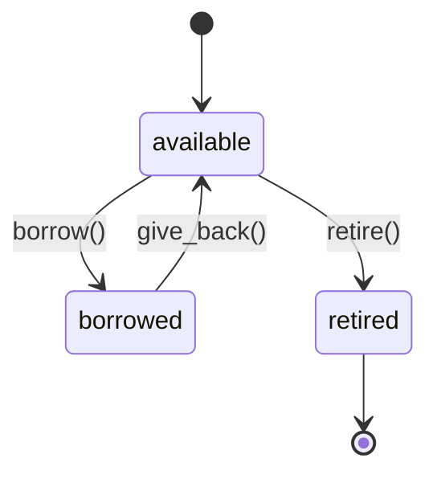

# Sistem Alur Perpustakaan (Milestone S01)

Mata kuliah MKB308 Pemrograman Berorientasi Obyek, Semester 3.

Proyek kecil yang menunjukkan *object thinking*: alur perpustakaan dirancang
setara dengan alur Simple Banking pada materi S01.

## Pemetaan Banking ke Perpustakaan

| Banking | Perpustakaan | Perubahan state |
|---|---|---|
| Create Account | Create Book + Member | Object dibuat, `status = "available"` |
| Withdraw | Borrow | `available` menjadi `borrowed` |
| Deposit | Return | `borrowed` menjadi `available` |
| Check balance | Check status | Membaca state |
| Close | Retire | Buku keluar dari koleksi |

## Desain Object

| Class | Responsibility | Identity | State | Behavior |
|---|---|---|---|---|
| `Book` | Menyimpan identitas buku dan status ketersediaannya | `book_id` | `status` | `borrow()`, `give_back()`, `retire()` |
| `Member` | Menyimpan identitas anggota dan buku yang dipinjam | `member_id` | `borrowed` | `borrow_book()`, `return_book()` |

## Diagram Class



## State Buku



## Aturan yang Dijaga Object

- Buku yang sedang dipinjam tidak bisa dipinjam lagi.
- Buku yang sedang dipinjam tidak bisa ditarik dari koleksi.
- Buku yang sudah `retired` tidak bisa dipinjam.
- Anggota maksimal meminjam 2 buku.
- Anggota tidak bisa mengembalikan buku yang tidak ia pinjam.

## Cara Menjalankan

Prasyarat: Python 3.8 atau lebih baru.

```bash
python perpustakaan_alur.py
```

Di Windows, bila `python` tidak dikenali, coba `py perpustakaan_alur.py`.
Di Linux/macOS, coba `python3 perpustakaan_alur.py`.

## Batasan Milestone S01

Belum memakai inheritance, database, UI, atau framework. Fokus pada model
object kecil: identity, state, behavior, dan responsibility.

## Pengembang

- Nama: (isi nama kamu)
- Dosen: Kodrat Mahatma, S.T., M.Kom
